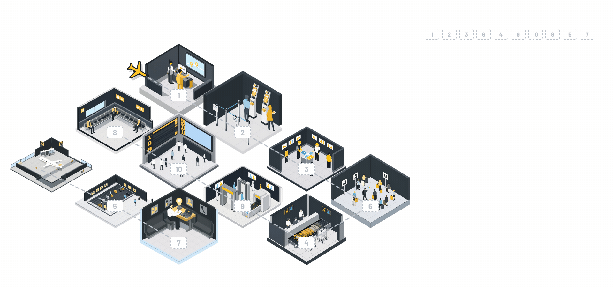

# Value Stream: Denah Bandara Isometrik (GIF / video)

Peta 10 value stream sebagai **denah bandara isometrik** yang dirakit dari 11 modul FLUX, dengan pesawat yang taxi, lepas landas, berputar, dan mendarat. Teks langkah muncul bergantian di panel kanan. Output: GIF (putih & transparan), MP4, PPTX satu slide. **1920×900** (pita lebar untuk diletakkan di bawah judul slide), ±45 detik, berulang.



## Design read
> *Satu slide animasi (GIF/MP4 di PowerPoint) untuk insan MIND ID; dunia **denah bandara isometrik (diorama terpotong)**; terang; satu sinyal kuning rambu bandara `#FFC629`; opsi B: denah utuh + panel teks.*

| Keputusan | Pilihan | Alasan |
|---|---|---|
| Ground & light | Putih; modul berlantai abu muda, dinding arang | Gaya referensi set denah; dinding gelap + signage kuning = bahasa wayfinding |
| Sinyal | Kuning: pesawat, plakat nomor, jejak kondensasi, sorotan "Di MIND ID" | Satu warna penunjuk posisi |
| Suara tipe | Barlow, label uppercase berspasi | Signage bandara |
| Gambar | 11 modul isometrik FLUX (resep gaya dikunci), latar dibuang, dirakit di grid isometrik oleh kode | FLUX tidak bisa menempatkan 11 zona tepat di rute dalam satu gambar |
| Motif | Garis rute ala peta transit (tepi putih) di atas denah; strip progres 10 plakat di panel | Rute terbaca di atas detail diorama |

## Denah dan alur
Grid isometrik 4×3 (sel 200×115,5 px, modul 255 px, ada lorong putih di antaranya):

| Baris | Modul (urutan perjalanan) |
|---|---|
| belakang | 1 agen perjalanan · 2 konter tiket · 3 imigrasi · 6 rombongan di check-in |
| tengah (balik) | 4 bag drop · 9 pemeriksaan keamanan · 10 papan keberangkatan · 8 ruang tunggu gate |
| depan | landasan · 5 aula kedatangan · 7 lounge |

Pesawat berhenti di tengah lantai tiap modul (plakat hantu → plakat kuning, panel berganti, strip progres maju). Setelah 8: taxi ke ujung landasan, lepas landas ke kanan atas (badan membesar, bayangan tertinggal di tanah, jejak titik kuning), berputar di langit kiri atas, turun dan mendarat, taxi ke 5 lalu 7. Di akhir panel menampilkan rekap 10 langkah selama 4 detik. Garis rute hanya digambar untuk 1→8 dan 5→7; taxi/landasan/penerbangan ditunjukkan oleh pesawat dan jejaknya (versi awal dengan garis landasan membentuk segitiga yang semrawut).

VS 8 ditempatkan di ruang tunggu gate (mengabari keluarga sebelum naik), sehingga lepas landas terjadi di antara 8 dan 5.

## Gambar
`images.jobs.json` — resep modul dikunci: *isometric 2D flat vector, one cutaway room module on a square floor platform, 30°, light grey tiled floor, two charcoal back walls, signs = pictograms only, no text*. 4 varian per modul; terpilih m1_1, m2_3, m3_3, m6_3, m4_3, m9_1, m10_2, m8_2, m5_2, m7_1, rw_3. Referensi gaya dari pengguna (ilustrasi stok) hanya dipakai sebagai acuan kata-kata, tidak dikirim ke FLUX.

## Render
```bash
cd decks/value-stream-airport-iso
NODE_PATH=../../node_modules:$(npm root -g) node render.js /tmp/vsa                 # MP4 + GIF (256 warna) + poster
NODE_PATH=../../node_modules:$(npm root -g) node render.js /tmp/vsa-t --transparent # GIF transparan + poster PNG beralfa
NODE_PATH=../../node_modules node make_pptx.js                                     # out/Value_Stream_Airport.pptx
```
- GIF putih memakai palet 256 warna: dengan 96 warna aksen biru muda (layar, kaca) berubah jadi abu.
- GIF transparan: `encode_transparent_gif.py` menulis **hanya persegi yang berubah** per frame dan memberi disposal "clear" pada frame sebelumnya hanya bila ada piksel yang harus kembali transparan (69 MB → 14 MB). Kontainer GIF dirakit sendiri; sub-gambar dienkode Pillow **dengan `interlace=False`** (default Pillow interlaced → baris teracak). `--verify` men-decode ulang dan membandingkan tiap frame.

## File di `out/`
- `value-stream-airport.gif` — 1920×900, 12,5 fps, ±2,9 MB.
- `value-stream-airport.mp4` — 25 fps, ±2,7 MB (bisa di-pause).
- `value-stream-airport-transparent.gif` — tanpa latar, ±14 MB; tepi dihaluskan terhadap putih → untuk slide terang.
- `Value_Stream_Airport.pptx` — satu slide: area judul di atas, GIF transparan 12,5" × 5,86" di bawahnya (`--white` untuk versi putih) + catatan pembicara.
- `poster.png`, `poster-transparent.png`, `modul-isometrik.zip` (11 modul PNG transparan).
