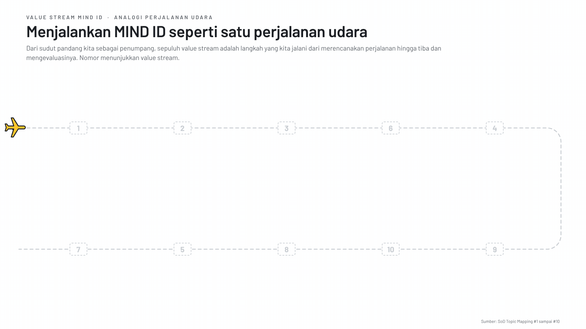

# Value Stream: Analogi Perjalanan Udara (versi GIF / video)

Peta perjalanan 10 value stream yang dirender menjadi **animasi GIF dan MP4** (1920×940, ±34 detik), siap ditempel ke PowerPoint sebagai satu objek. Cakupan: hanya rute dan sepuluh langkah (tanpa judul, label fase, pesan kunci) sesuai revisi pengguna; konten "Di MIND ID" versi revisi (kalimat lengkap). Desain tanpa standar brand MIND ID, ilustrasi 2D flat dari NVIDIA FLUX klein.



## Design read
> *Satu slide peta perjalanan yang diputar otomatis (GIF/MP4 di PowerPoint); dunia **papan petunjuk bandara (wayfinding)**; terang; satu sinyal kuning rambu bandara `#FFC629`.*

| Keputusan | Pilihan | Alasan |
|---|---|---|
| Ground & light | Putih `#FFFFFF`, tinta arang `#1C1F24` | Ilustrasi flat bertumpu pada elemen putih; di latar gelap mereka "bolong" (dicoba, ditolak) |
| Sinyal | Kuning rambu bandara: pesawat, plakat nomor, sorotan "Di MIND ID", halo titik aktif | Yang diikuti mata = penanda gerbang/posisi |
| Suara tipe | Barlow (DIN-like, gaya signage), label uppercase berspasi | Huruf papan petunjuk bandara |
| Gambar | Ilustrasi 2D flat FLUX (kuning/biru muda/putih), latar dibuang lewat flood-fill dari tepi | Satu keluarga ikon yang konsisten |
| Motif | Nomor value stream sebagai **plakat gerbang** kuning; label fase sebagai pil arang bertulisan kuning dengan panah | Bahasa wayfinding terminal |

## Alur animasi
Rute rencana (abu putus-putus) dan plakat hantu terlihat dari awal → pesawat kuning terbang di sepanjang rute (SVG path, kecepatan 520 px/s, ease in-out per kaki) dan meninggalkan garis arang → di tiap titik: plakat muncul (pop), halo kuning berdenyut selama pesawat parkir, ilustrasi naik + teks muncul → pesawat mendarat di pin tujuan, tahan 3 detik, lalu berulang. Pesawat berada di bawah plakat sehingga nomor tetap terbaca dan sayapnya menyembul.

Urutan: 1 → 2 → 3 → 6 → 4 → 9 → 10 → 8 → 5 → 7 → tiba.

## Cara render
`scene.html` punya `render(t)` yang deterministik; `render.js` memotret tiap frame dengan Playwright lalu meng-encode dengan ffmpeg.
```bash
cd decks/value-stream-flight-gif
NODE_PATH=../../node_modules:$(npm root -g) node render.js /tmp/vsf        # frames + MP4 + GIF + poster
cp /tmp/vsf/value-stream-flight.gif /tmp/vsf/value-stream-flight.mp4 /tmp/vsf/poster.png out/
NODE_PATH=../../node_modules node make_pptx.js                            # out/Value_Stream_Flight.pptx
```
Cek cepat beberapa frame: `node render.js /tmp/t --only 3.2,14.5,40`.

## Gambar
`images.jobs.json` (gaya flat 2D, latar putih). Terpilih: vs1_3, vs2_6, vs3_4, vs6_3, vs4_3, vs9_1, vs10_3, vs8_3, vs5_2, vs7_2. Ditolak: semua varian awal tiket/paspor (angka & teks palsu: "295", "APPROVED YISA") → di-generate ulang dengan "blank, no writing".

## File di `out/`
- `value-stream-flight.gif` — 1920×940, 12,5 fps, berulang (±1,2 MB). Tempel ke slide; diputar saat slideshow.
- `value-stream-flight.mp4` — 1920×940, 25 fps (±1,4 MB). Insert → Video bila ingin bisa di-pause.
- `Value_Stream_Flight.pptx` — satu slide berisi GIF selebar slide (ruang judul di atas) + catatan pembicara.

Revisi konten (dari screenshot pengguna): kalimat "Di MIND ID" lengkap untuk 10 langkah; VS2 "Memilih tiket *best value*"; VS5 "…biaya, dan itinerary yang tercapai"; VS10 "…sebelum mengambil keputusan kelanjutan perjalanan"; italic untuk *best value*, *talent*, *continuity*, *improvement*. Typo "strategisdan" di sumber ditulis "strategis dan".
- `poster.png` — frame akhir (untuk cetak / thumbnail).

### Versi transparan (tanpa latar putih)
- `value-stream-flight-transparent.gif` — 1920×940, latar transparan (±17 MB). Untuk slide berlatar **putih / terang**: GIF hanya punya transparansi penuh-atau-tidak, jadi tepi huruf dan ilustrasi dihaluskan terhadap putih (`--matte`). Di latar gelap akan tampak tepi pucat, dan teks arang tidak terbaca.
- `poster-transparent.png` — frame akhir dengan alfa penuh (PNG).
- `ilustrasi-transparan.zip` — 10 ilustrasi FLUX sebagai PNG transparan.

Bedanya dengan versi putih: halo kuning yang berdenyut dihilangkan (semi-transparan tidak bisa di GIF); rute di bawah plakat dilubangi dengan SVG mask, bukan ditutup warna putih.
```bash
NODE_PATH=../../node_modules:$(npm root -g) node render.js /tmp/vsf-t --transparent [--matte F2F2F2]
```
Ukurannya lebih besar daripada versi putih karena tiap frame harus disimpan utuh (disposal "restore to background") agar pesawat tidak meninggalkan jejak; frame identik digabung (421 → 225 frame).

Font Barlow (SIL OFL, `fonts/OFL.txt`) hanya dipakai saat render; file GIF/MP4 tidak butuh font terpasang.
