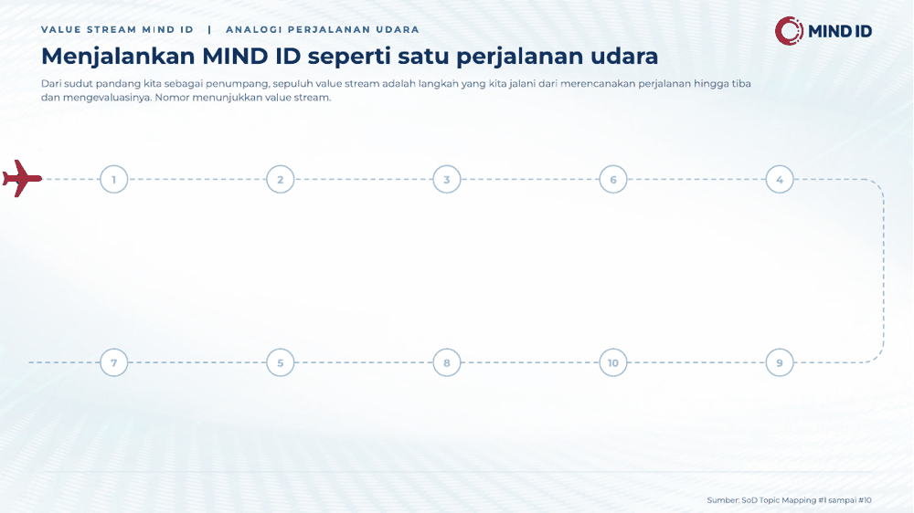

# Value Stream MIND ID: Analogi Perjalanan Udara

1 slide · 11 klik animasi · redesign dari slide statis (semua teks, nomor value stream, sumber dan ilustrasi dipertahankan) · brand MIND ID.



## Design read
> *Satu slide peta 10 value stream untuk insan MIND ID, ruang rapat terang; brand MIND ID menggantikan palet genre; dunia **rencana penerbangan (flight plan)**; terang; sinyal merah `ED1C24` = pesawat, "posisi kita sekarang".*

Genre dasar: corporate-trust (brand institusional) dibelokkan ke peta rute. Yang dipinjam: palet brand, Montserrat (pengganti Gotham), label fase uppercase. Yang diubah: rute jadi vektor yang dianimasikan, bukan bagian gambar latar.

## Lima keputusan dunia
| Keputusan | Pilihan | Alasan |
|---|---|---|
| Ground & light | Latar konten resmi brand (`content-light.jpg`), terang | Slide brand MIND ID untuk ruang rapat |
| Sinyal | Merah brand untuk pesawat, tujuan, dan "Di MIND ID:" | Satu hal yang diikuti mata: posisi saat ini |
| Suara tipe | Montserrat bold navy, label uppercase berspasi | Sistem tipe brand |
| Gambar | Ilustrasi isometrik asli (vs1–vs10), muncul saat pesawat tiba | Aset milik klien, sudah on-brand; tidak perlu FLUX |
| Motif | Rute rencana putus-putus pucat → rute navy digambar di belakang pesawat; titik singgah terisi saat dicapai | "Garis yang berjalan" memandu urutan baca |

## Alur animasi (11 klik)
Urutan perjalanan, bukan urutan nomor: **1 → 2 → 3 → 6 → 4 → 9 → 10 → 8 → 5 → 7 → tiba**.
Setiap klik: segmen rute di-*wipe* searah perjalanan + pesawat bergerak di motion path yang sama → lingkaran navy bernomor muncul → ilustrasi → teks. Label fase muncul saat fasenya dimulai (klik 1, 6, 9). Klik 6 menggambar belokan: ekor → sudut → turun → sudut → baris bawah, pesawat berputar 90° di tiap sudut. Klik 11: pesawat mendarat dan menghilang, pin tujuan dan pesan kunci muncul.

Kecepatan garis konstan (3,7"/detik) sehingga wipe dan pesawat sinkron. Pesawat diletakkan di bawah lingkaran nomor: saat tiba, lingkaran menutupi badannya, sayapnya tetap terlihat.

## File
- `build.js` → membangun .pptx lalu memanggil `scripts/add_animation.py` dengan `animation.json` (ditulis oleh build).
- `notes.json` → naskah presenter per klik.
- `preview.gif` → storyboard dari `scripts/storyboard.py` (LibreOffice tidak memutar animasi PowerPoint).

```bash
NODE_PATH=$PWD/node_modules node decks/value-stream-mind-id/build.js decks/value-stream-mind-id/MIND_ID_Value_Stream.pptx
python .claude/skills/deck-house-style/scripts/check_pptx.py decks/value-stream-mind-id/MIND_ID_Value_Stream.pptx
python .claude/skills/deck-house-style/scripts/storyboard.py decks/value-stream-mind-id/MIND_ID_Value_Stream.pptx decks/value-stream-mind-id/animation.json /tmp/sb --mover pesawat
```

## Catatan
- Font Montserrat harus terpasang di laptop presentasi (deck asli juga memakainya).
- Animasi diverifikasi secara struktural (validasi skema + storyboard per klik); putar sekali di PowerPoint sebelum presentasi untuk memastikan timing terasa pas.
